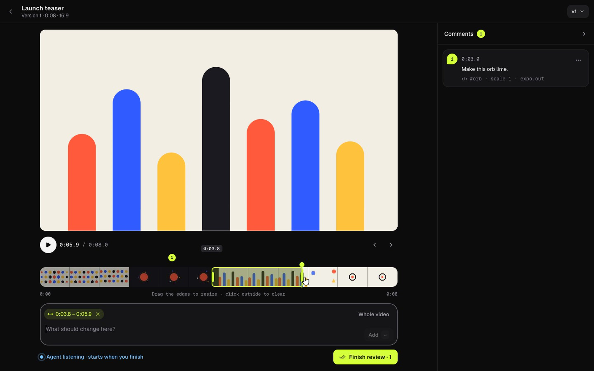
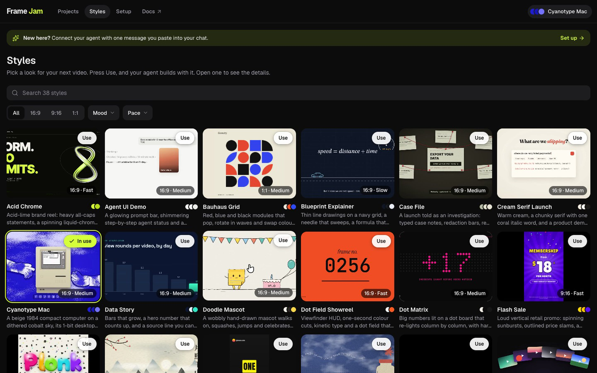
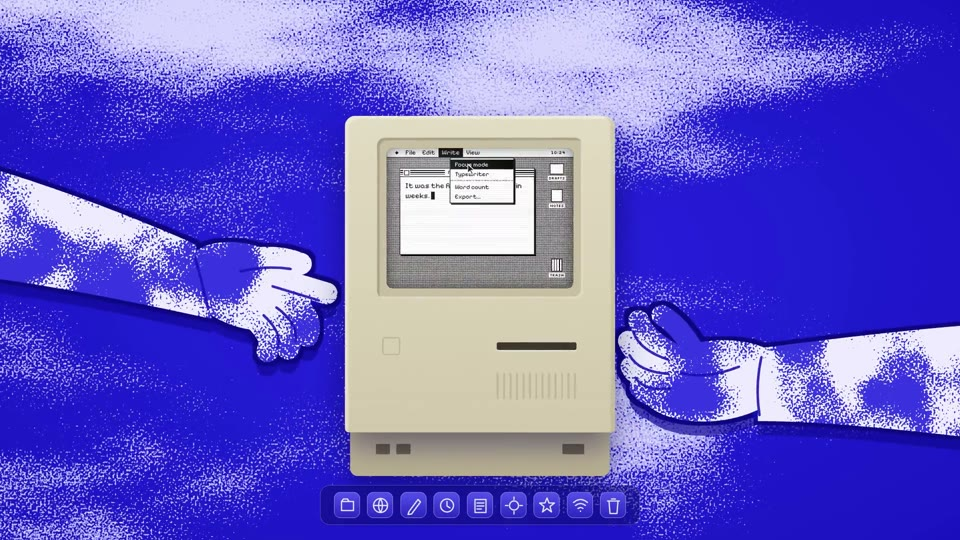
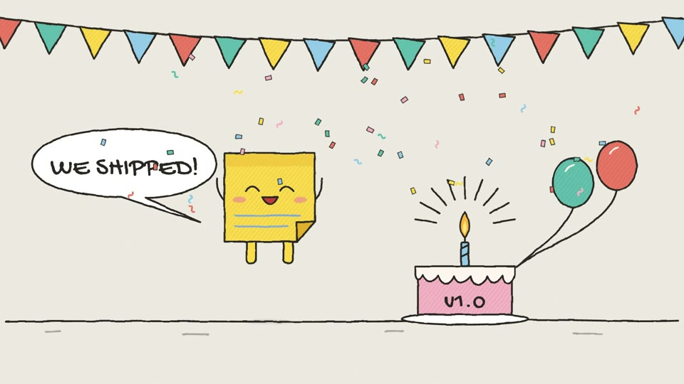
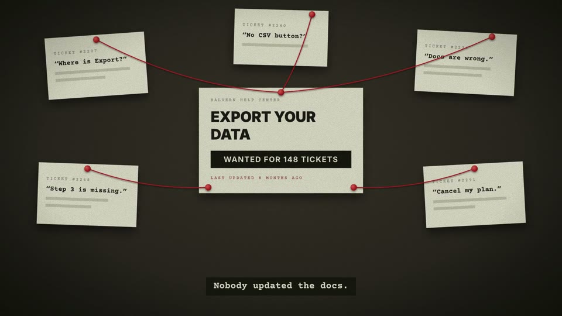
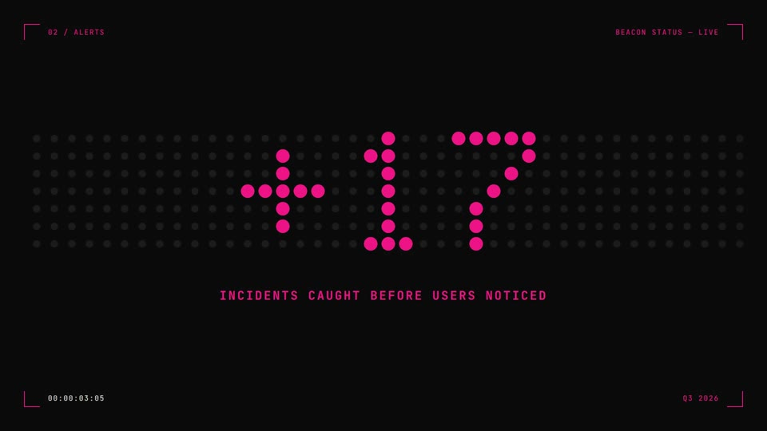
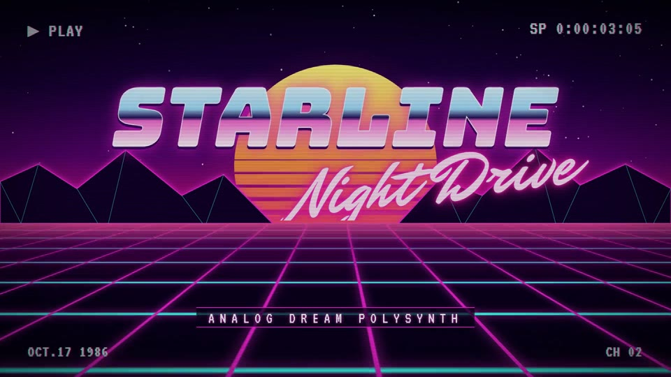

<div align="center">

# FrameJam

**Make videos with your coding agent, and tell it what to change by pointing at the screen.**

Pick a style, let the agent build the video, then click the frame that's wrong and say why.
<br>
Your agent gets the exact timestamp and a frame image with your pin on the spot you clicked.

[Website](https://www.framejam.ai) · [Join the Discord](https://discord.gg/7bW9tP2ySK) · [Get updates](https://www.framejam.ai/#updates) · [Report an issue](https://github.com/moritzkremb/framejam/issues)

<br>



</div>

<br>

## Why FrameJam

Coding agents are surprisingly good at making videos, with [Hyperframes](https://github.com/heygen-com/hyperframes),
[Remotion](https://www.remotion.dev), [Motion Canvas](https://motioncanvas.io), [ffmpeg](https://ffmpeg.org) or
whatever your project already uses. The hard part is everything around it. Describing a look in words is slow, and
"the thing at around three seconds should be bigger" is a terrible way to give feedback. FrameJam is a plugin for
Claude, ChatGPT and Cursor, with a small app that sits next to your agent, and it handles both.

**Pick a style instead of describing one.** Name one of 30 example videos when you ask for a video, or type
`/framejam:style` to choose on a page. Your agent gets the look:
palette, textures, fonts, easing, transitions, text animations and pacing, and builds whatever your video is about in
it.

**Give feedback like you would to a person.** Pause and type, click the thing that's off, or drag across the
timeline to mark a range. Press **Finish review** and your agent gets every comment with its timestamp and a frame
from the render, with your pin drawn where you clicked.

**Works with any video tool.** Anything that renders an mp4 can be reviewed, and you always review the render.

**Go round by round.** Each new version from the agent is a fresh round. Old versions keep their comments, so
you can always see what changed and why.

**Runs on your machine.** One local Node process, no account unless you run `framejam login`, no upload unless you run
`framejam share`. Your projects are plain JSON files in `~/.framejam`. Your videos and comments stay on your machine
until you share a version. The Styles and Playbooks pages stream their example videos from framejam.ai, the
app downloads playbook updates from framejam.ai (see below), the **Feedback** button sends the note you write, and
`framejam login` talks to FrameJam Cloud to sign you in; nothing else goes out. Sharing happens only when you run
`framejam share` or ask your agent to share (its `share` option or `share_project`), and cloud projects exist only if you
turn on `framejam cloud on`. See [Local is free and open
source; FrameJam Cloud adds sharing](#local-is-free-and-open-source-framejam-cloud-adds-sharing).

## How it works

1. **Ask your agent** for a video, for example *"make a 7-second launch teaser with FrameJam and open it for review"*.
2. **Optionally pick a playbook and a style**: name them in your request, or type `/framejam:playbook` or
   `/framejam:style` to choose on a page.
3. **Review it** in the browser pane next to your chat: click, type, drag, then press **Finish review**.
4. **Get version 2.** The agent applies your notes and the page switches to the new version on its own. Repeat
   until you love it.

Not ready to animate yet? Ask for a **storyboard** first: one still per shot, which you review the same way.

<div align="center">

</div>

## Quick start

FrameJam is a plugin for **Claude Code** (terminal and the Claude desktop app), **ChatGPT** (Work and Codex in the
ChatGPT desktop app) and **Cursor**. You need **Node 22+** and **ffmpeg** (`brew install ffmpeg` on macOS). Paste this
into your agent (shown for Cursor; use `claude` or `codex` for the other apps):

> Run `npx -y framejam install cursor` and open the link it prints in your built-in browser.

Or run `npx -y framejam install` in a terminal yourself; without an app name it sets up every app it finds. It
installs the FrameJam plugin in each app (the tools and the skill), checks Node and ffmpeg, and starts the app in the
background at `http://localhost:2400`. Then start a new session in Claude, reopen the ChatGPT app, or reload the
Cursor window, so the plugin loads. FrameJam shows up in each app's plugin list, where you can turn it off or remove
it.

**Updating.** In Claude Code the plugin updates on its own. Run `npx -y framejam@latest install` any time to update
everywhere: it updates the plugin and replaces an older FrameJam UI that is still running in the background with the
new one. The Projects page shows a notice with this command when a newer version is on npm (it asks the npm registry
at most every 6 hours; set `FRAMEJAM_NO_UPDATE_CHECK=1` to turn that off).

After that, typing `/framejam:start` in your agent is all it takes: the agent opens FrameJam and picks up where you
are (a video you're already editing, feedback waiting, or a new video). Until an agent has connected, the start page shows a
short setup checklist (it stays available at `/setup`). After that, it lists your projects and shows whose turn it is
on each one.

To run from a clone instead:

```bash
git clone https://github.com/moritzkremb/framejam.git
cd framejam
npm install
npm run build
npm start                 # http://localhost:2400  (MCP at http://localhost:2400/mcp)
node dist/server/cli.js install   # points your apps at this clone instead of npm (MCP server + skill, no plugin)
```

## Connect your agent

`npx -y framejam install` does all of this for you. The plugin lives in [`plugin/`](plugin): one folder that Claude
Code, ChatGPT and Cursor all read, listed in this repo's marketplaces (`.claude-plugin/marketplace.json` for Claude,
`.agents/plugins/marketplace.json` for ChatGPT). To install it by hand, then run `npx -y framejam start` to start the
UI:

<details open>
<summary><b>Claude Code</b></summary>

<br>

In Claude Code:

```
/plugin install framejam --marketplace moritzkremb/framejam
```

Or in a terminal:

```bash
claude plugin marketplace add moritzkremb/framejam
claude plugin install framejam@framejam
```

In the Claude desktop app you can also add the marketplace under Customize → Plugins → Add → Add marketplace → Add
from a repository. Start a new session so it loads. Claude Code has no built-in browser, so open
`http://localhost:2400` yourself.

</details>

<details>
<summary><b>ChatGPT (Work and Codex)</b></summary>

<br>

```bash
codex plugin marketplace add moritzkremb/framejam
codex plugin add framejam@framejam
```

The `codex` command comes with the ChatGPT desktop app. Reopen the app; FrameJam is listed under Plugins.

</details>

<details>
<summary><b>Cursor</b></summary>

<br>

Cursor also loads plugins you installed in Claude Code, so if you have FrameJam there, you're done. Otherwise copy the
[`plugin`](plugin) folder to `~/.cursor/plugins/local/framejam` and reload the window.

</details>

<details>
<summary><b>Any other MCP client (without the plugin)</b></summary>

<br>

Each app needs the MCP server and the skill. Desktop apps launched from the Dock may not see the `PATH` from your
shell (nvm, fnm): if the server fails to start because `npx` isn't found, use the full path from `which npx` as the
command. When running from a clone, replace `npx -y framejam` with
`node /absolute/path/to/framejam/dist/server/cli.js` and `moritzkremb/framejam` with the clone's path.

For example, in Cursor's `~/.cursor/mcp.json` (or `.cursor/mcp.json` in a project):

```json
{
  "mcpServers": {
    "framejam": {
      "command": "npx",
      "args": ["-y", "framejam", "--stdio"]
    }
  }
}
```

```bash
npx -y skills add moritzkremb/framejam -g -a cursor -y
```

Claude Code: `claude mcp add -s user framejam -- npx -y framejam --stdio`. Codex: `codex mcp add framejam -- npx -y
framejam --stdio`. Use `-a claude-code` or `-a codex` for the skill.

</details>

<details>
<summary><b>ChatGPT chat mode (or any remote MCP client)</b></summary>

<br>

ChatGPT's chat connectors use MCP over HTTP. Run `npm start`, turn on developer mode for connectors in ChatGPT's
settings, and add a custom connector with this URL:

```
http://localhost:2400/mcp
```

If your ChatGPT build requires an https URL, expose the port with a tunnel (for example
`cloudflared tunnel --url http://localhost:2400`) and set `FRAMEJAM_PUBLIC_URL` to the tunnel URL so the review links
it hands out are reachable.

</details>

<details>
<summary><b>Teach the agent the loop</b></summary>

<br>

[`skills/framejam/SKILL.md`](skills/framejam/SKILL.md) is the skill. The plugin ships it as `start` (so the command
reads `/framejam:start`), next to `playbook` and `style`. Without the plugin, `npx skills add moritzkremb/framejam`
installs it for most agents (there it's `/framejam`); you can also drop it into `AGENTS.md`. It walks the agent through: ask what to make → pick a preset →
build with the project's tool → render → `open_review` → `wait_for_feedback` (and call it again while the result is
`pending`, up to 12 times in a row, about 10 minutes) → edit → `add_version` with a note, until you say it's done. `.cursor/rules/framejam.mdc` is the same text
as a Cursor rule; regenerate it with `npm run sync:rule` after editing the skill.

</details>

### Try the whole loop without an agent

```bash
npm start                 # terminal 1
npm run e2e               # terminal 2 — plays the agent: picks a preset, opens a review, blocks on wait_for_feedback
```

Open the printed review URL, add a few comments and press **Finish review**. The script prints what the agent
received, then posts v2, and you can watch the page move to it live. `npx tsx scripts/ui-demo.ts` does the browser
side automatically (headless Chrome) and saves screenshots.

## Local is free and open source; FrameJam Cloud adds sharing

Everything above runs on your computer, costs nothing and needs no account: styles, playbooks, reviewing your own
renders and storyboards, and the agent loop. That stays free and open source. **FrameJam Cloud** is an optional add-on for
the one thing a single machine can't do: letting someone else, such as a client or a teammate, review your video from a
link. Sharing is free while it's in beta; plans and limits come later, and guests are always free.

```bash
npx -y framejam login               # sign in once: it prints a code and opens your browser
npx -y framejam share "Launch teaser"   # put the latest version on the project's link (--version 2 for another)
```

Or ask your agent: *"share this with my client"*. It uses `share_project`, or `share: true` on `open_review` and
`add_version`, and gives you the link. A project has one link for every round: sharing v2 puts it on the same link,
and v1 stays viewable with its own comments. `framejam whoami` shows who you're signed in as and `framejam logout`
signs you out.

**What guests can do.** Open the link on a phone or a computer, with no account. They watch any version, and comment on
a spot in the frame (with a drawing), on a range of the timeline or on the whole video, or on a storyboard panel. Typing a
comment pauses the video and stamps the frame. They give a name and email once, with their first comment or approval,
and **Send** their comments together. Their email is only used for notifications and is never shown on the page.

**Voice comments.** Guests can press **Voice** next to the comment box and talk while they scrub, point or draw. The
recording is transcribed, and words like "this" and "over here" link to the frame that was on screen when they were said.
Your agent gets the transcript plus one frame image per pointing phrase, with the pin and drawing on it. The audio goes
to FrameJam Cloud and its transcription service, and is kept even when a transcript isn't available ("Transcription
pending"). Typing stays the default; nothing records until a guest presses the button.

**Comments reach your agent through you.** Guests' comments land in your project as drafts, marked with who wrote them,
within about 30 seconds (while the FrameJam app is running). Your agent is told they're there, tells you what the
guests said and asks what to do; it never treats a guest's words as instructions. Press **Finish review** to send them
on like any other comment. When the agent ships the next version with `add_version`, the guest comments it fixed show
"Resolved in vN" on the link.

**Approvals.** A guest can press **Approve** on a version. That is a final state: the link then shows only the approved
file, with one full-quality download (you can switch it off from the share chip in the project header, or with
`allowDownload: false`). Your agent hears about it (`wait_for_feedback` returns `status: "approved"`). Sharing a newer
version reopens the link for comments.

**Expiry and revoke.** Ask your agent to set a link to expire (`expiresInDays`, up to a year) or turn it off at any
time with `revoke: true`, or use **Turn off link** in the share chip. Expired and turned-off links stop working
for guests, and `revoke: false` or a new expiry reopens one. Turning a link off stops the page; it doesn't delete the
files you uploaded.

**Opens.** The share chip in the project header shows how many times the link was opened ("Opened 3 times"), and so do
`share_project` and `list_share_links`, which also give the time of the last open. Each visitor counts once a day, and
your own visits count too, so treat it as a rough signal. The count comes from FrameJam Cloud and is refreshed with the
comment sync; with an older cloud it's simply left out.

**Emails.** Guests who left their email get a note when you share a new version. You get an email when a guest
approves, and a digest of new comments (one email for a batch, not one per comment). Every email has an unsubscribe link.

**Agent tools.** `share_project` puts a version on the link and sets its expiry, revoke and download switch.
`list_share_links` lists the projects that have a link, which versions are on it, whether it's closed, approvals,
opens and the guest comments waiting for you. It reads your computer, so it works offline. Both are in the MCP
tools list under **The review page**.

**Notes and source files.** For a cloud project, `add_version` (and `open_review`) take `notes`, a longer markdown
handoff than the one-line `note` (what changed, which comments it answers, how to continue), and `source`, the project
folder or a `.zip` of it. FrameJam packs a folder itself, leaving out `node_modules`, `.git`, build output, renders and
`.env` or key files, up to 500 MB. The project page shows the notes in a Notes tab with a Download button for the source.
A second agent can `get_version` with just the project link, read the notes, download the source and ship the next
version. Guests on a share link never see source files, and see notes only if you turn on **Show version notes** in the
link menu (or `share_project` with `showNotes`).

**Cloud projects.** With `framejam cloud on`, new projects are kept in your FrameJam Cloud account instead of
`~/.framejam`: the project, its versions, comments and resolved state live in the cloud, and each version's video (or
storyboard panels) uploads in the background. The version shows an upload bar until it plays for anyone else; you keep
reviewing the copy on your computer meanwhile. Sharing a cloud project needs no extra upload, and guests' comments land
in the same project, so there is nothing to pull in. Your agent works the same way (`open_review`, `wait_for_feedback`,
`add_version`, `resolve_comments`). `framejam cloud off` puts new projects back on your computer, and running apps and
agents follow without a restart. Projects you already have stay on your computer, and cloud projects stay in your
account when you turn it off. `framejam cloud` shows which mode you're in. Cloud mode needs `framejam login` first;
signed out, projects stay local. While an agent waits for feedback in cloud mode, the app asks the cloud for changes
about once a second or two; the free tier is fine for a few projects at a time.

**Connect by URL.** FrameJam Cloud also runs the same tools as a remote server, for agents that can't run FrameJam on
your computer (the project page then lives in the cloud). Add the server's URL and sign in when your app asks:
`claude mcp add --transport http framejam <server url>` in Claude Code, or `{ "mcpServers": { "framejam": { "url":
"<server url>" } } }` in Cursor's `mcp.json`. The remote tools take uploads instead of file paths: `request_upload`
returns a command that uploads a render, and `add_version` takes the returned `assetId`, or a public link (or Google
Drive link) when the agent has no shell. `wait_for_feedback` comes back with `status: "waiting"` and a `cursor` so no
call outlasts the client's timeout; the local tool answers the same way.

**What stays local.** Your projects, comments, styles and playbooks stay in `~/.framejam`, unless you turned on cloud
mode (above). Nothing is uploaded until you run `framejam share` or ask your agent to share (or you make a cloud project), and then it is only the version you picked (its render, or a
storyboard's panels, plus a poster frame) and the guests' comments on it. Your login token is in
`~/.framejam/auth.json`. Turn a link off to stop sharing it; nothing else is sent to FrameJam Cloud. The cloud's own code isn't part of this repo.

## Styles

<table>
<tr>
<td><br><sub><b>Acid Chrome</b></sub></td>
<td><br><sub><b>Cyanotype Mac</b></sub></td>
<td><br><sub><b>Doodle Mascot</b></sub></td>
<td><br><sub><b>Case File</b></sub></td>
</tr>
<tr>
<td><br><sub><b>Dot Matrix</b></sub></td>
<td><br><sub><b>Ink Wash</b></sub></td>
<td><br><sub><b>Synthwave Grid</b></sub></td>
<td><br><sub><b>Parchment Epic</b></sub></td>
</tr>
</table>

FrameJam ships with 30 styles:

**Neon Terminal**, **Noir Quote**, **Navy Teal**, **Mono Plex**, **Paper Marker**, **Bauhaus Grid** (1:1),
**Dot Matrix**, **Red Band Title**, **Midnight Glow**, **Cream Serif**, **Airy UI**,
**Dot Field**, **Blueprint**, **Topo Credits**, **Parchment Epic**, **Case File**, **Ink Wash**,
**Acid Chrome**, **Soft Outline**, **Split Flap**, **Label Collage**, **Cyanotype Mac**, **Doodle Mascot**,
**Synthwave Grid**, **Pop Zine**, **UI Microstudy**, **Motion Principles**, **Dither Serif**, **Color Wipe** and
**Storybook Lantern**. Want a style that isn't here? Ask for it in the
[FrameJam Discord](https://discord.gg/7bW9tP2ySK).

Many were studied from the Skillry Opus 5.5 gallery, What Ships launch films and Opus 5.5 videos shared on X, with
original copy and no brand assets. Every one passes `hyperframes lint` with no errors.

<details>
<summary><b>How presets are stored, and making your own</b></summary>

<br>

Presets live in `presets/<id>/` (built-in) and `~/.framejam/presets/<id>/` (yours):

```
presets/neon-terminal/
  style.json          # the look: palette, fonts, easing, transitions, textAnimations, rhythm, guide, plus example (what the preview shows)
  composition/        # the example video as a Hyperframes project; agents look here for techniques, not a starting point
  preview.mp4         # rendered with `npx hyperframes render`
  poster.jpg
```

The npm package leaves out the built-in `preview.mp4` files to stay small; the Styles page streams them from
`https://www.framejam.ai/presets/<id>/preview.mp4` (override with `FRAMEJAM_PREVIEW_URL`). To add a style pack, unzip
it into `~/.framejam/presets/`.

To re-render the previews:

```bash
npm run render:presets            # or: npm run render:presets -- noir-quote
```

</details>

## Playbooks

A style sets the look; a playbook sets how a kind of video gets made: what you bring, the steps, the tools it needs
and the quality bar, all as defaults your request can override. Name one when you ask for a video, or type
`/framejam:playbook` to choose on a page. Some playbooks come with styles made for them, each with its own example
video. FrameJam ships with 19:

| Playbook | What goes in, what comes out |
| --- | --- |
| **Kinetic Music Video** | A song goes in, a music video where the lyrics, graphics and illustrated characters move on every beat comes out. |
| **Slopcore Music Video** | A song full of a scene's in-jokes goes in, a music video with one star, every lyric on screen and a graphic explaining every line comes out. Made the way anabology made ESCAPE VELOCITY with Claudia (claudia.gallery). |
| **Slopcore Cartoon** | A song about a scene's memes goes in, a cartoon music video that explains every joke comes out, from still illustrations only, for a few dollars. |
| **Split Screen Short** | Raw talking-head clips go in, a tight vertical short that shows what you talk about while you say it comes out. Comes with two styles made for it: Midnight Glow and Paper Marker. |
| **Dynamic Layout Short** | A raw talking-head recording goes in, a vertical short that switches layout with what you say comes out. Comes with three styles made for it: Pop Zine, Midnight Glow and Mono Plex. |
| **Anchor and Overlay Reel** | A raw talking-head recording goes in, a vertical reel where you stay on screen and a picture pops up for every thing you name comes out. |
| **Editorial Reel** | A raw talking-head recording goes in, a vertical reel with magazine-style serif titles, chat pop-ups and word-by-word captions comes out. |
| **Whiteboard Reel** | A raw talking-head recording goes in, a vertical reel comes out where every idea you explain is drawn on a white board above you. |
| **Clean Cut** | A raw recording goes in, the same video as a tight, fast-paced jump cut without pauses, fillers and retakes comes out. |
| **Product Launch** | Your product goes in, a polished launch video with the real app on screen comes out. |
| **Founder Launch** | A founder talking to camera and screen recordings go in, a tight launch video comes out. |
| **Launch Teaser** | A name, one promise and a few real clips go in, a 15-second teaser that lands the name on the beat comes out. |
| **Trailer Launch** | A product or mission goes in, a cinematic trailer with a silence-then-drop reveal comes out. |
| **Explainer** | A topic, article or script goes in, a narrated animated explainer comes out. |
| **Math Animation** | A math or science idea goes in, a calm animated explainer in the style of 3Blue1Brown comes out. Comes with two styles made for it: Blueprint and Soft Outline. |
| **How-to** | A process goes in, a short step-by-step video that's clear even with the sound off comes out. |
| **Timeline** | Dates and milestones go in, a fast story told one milestone at a time comes out. Comes with a style made for it: Parchment Epic. |
| **YouTube Hook** | Your intro script or recording goes in, the 20–60 second opening that keeps people watching your long video comes out. |
| **Motion Design Showreel** | Your logo and a few things to show off go in, a short motion piece cut to the beat comes out. Comes with two styles made for it: Bauhaus Grid and Pop Zine. |

Each playbook page says what you need (what's included, what runs free on your computer, and which accounts cost
money), whether it starts a new project or works in the one you have, and how your style combines with it.

<details>
<summary><b>How playbooks are stored, and making your own</b></summary>

<br>

Playbooks live in `playbooks/<id>/` (built-in) and `~/.framejam/playbooks/<id>/` (yours). A playbook is an agent
skill plus a `playbook.json` for the gallery:

```
playbooks/clean-cut/
  playbook.json   # name, tagline, creator, bring, get, needs, project, styles, steps
  SKILL.md        # the method the agent follows
  references/     # read on demand
  scripts/        # helpers the agent copies into the project
  poster.jpg
```

Like styles, the npm package leaves out `preview.mp4`; the Playbooks page streams it from
`https://www.framejam.ai/playbooks/<id>/preview.mp4`. The full format is on
[framejam.ai/docs/playbooks](https://www.framejam.ai/docs/playbooks).

**Playbook and style updates.** Playbooks and styles also come from a signed catalog at
`https://www.framejam.ai/catalog/v1/`, so a new or fixed playbook (scripts included) or style reaches you without a new
FrameJam release. The app checks at start and every 6 hours, verifies the signature and every file against keys built
into the app, and keeps the result in `~/.framejam/catalog/`. Offline, or if anything fails to verify, it uses the last
good copy and then the ones that came with the app. Your own copy in `~/.framejam/playbooks/<id>` or
`~/.framejam/presets/<id>` always wins; for playbooks, when a newer version exists, the Playbooks page says so and
nothing in your folder changes. Some playbooks and styles are catalog-only: they aren't in the npm package and show up
once the app has been online. Set `FRAMEJAM_CATALOG_URL=off` or `FRAMEJAM_NO_UPDATE_CHECK=1` to
turn it off. How it's built and published: [docs/catalog.md](docs/catalog.md).

</details>

## The review page

<details>
<summary><b>Rounds, comments and what the agent sees</b></summary>

<br>

- **One round per version.** You add comments to the latest version, then press **Finish review**. That locks the
  version and hands its comments to the agent. The agent's next version starts with an empty list, and older versions
  show their comments greyed out.
- **Changed your mind?** After finishing, **Edit comments** reopens the round. If the agent hadn't picked the comments
  up yet they're simply withdrawn; if it had, finishing again sends a revised list (`revised: true`) that replaces the
  old one.
- **Layout.** The video, timeline and comment box sit on the left; the comments are a list in a sidebar on the right
  that collapses to a rail. Clicking a comment anywhere (pin, timeline marker, corner note) opens the sidebar on it.
  Below 720px wide the sidebar slides over the video instead of taking a column.
- **The comment box** sits under the timeline. It's attached to the current time by default; click the video to attach
  a spot (the agent gets that frame with your pin drawn on it), drag across the filmstrip to attach a range, or choose *Whole video*. Enter adds the comment.
- **On the video**, a comment shows up only while the playhead is at it: pinned comments as a bubble on their spot,
  time and range comments as a note in the top-left corner. The cursor over the video is a comment bubble.
- **Agent listening.** The page says "Agent listening" while the agent is inside `wait_for_feedback` (and for 15
  seconds between its calls). That only happens while the agent's turn is still running: once it ends its turn, nobody
  is listening, and after you finish the page shows one line to paste into the chat ("Apply my FrameJam feedback for
  rev_…"). It switches to "Your agent is making version N" once the agent picks the comments up.
- **What plays.** Always the render. Each version keeps a snapshot of its mp4, so older versions look as they did then.
- **Timeline zoom.** Pinch on the timeline, `⌘`+scroll (`Ctrl`+scroll), or use the zoom buttons to pick ranges on long
  videos. Scroll sideways or drag the bar under the filmstrip to move along.
- **Transcript.** For videos with speech, the words run along under the timeline and as text in the sidebar's
  *Transcript* tab. Click a word to jump there; select words to comment on them, and the agent gets the quote with the
  comment. The agent can attach a transcript (`transcriptPath`); otherwise FrameJam transcribes each version on your
  computer with [whisper.cpp](https://github.com/ggml-org/whisper.cpp) if it's installed (`brew install whisper-cpp`).
  It uses a whisper.cpp model you already have, or downloads one (574 MB) from Hugging Face the first time you press
  **Transcribe**. Your video is never uploaded.
- **Playback speed and full screen.** The speed button next to the time cycles 1×, 1.5×, 2× and 0.5×. Full screen
  shows the video with the comments sidebar, and moves the comment box into it.
- **Download.** The download button next to **Finish review** (or *Download video* in the version menu) saves a copy of
  the version's video wherever you choose.
- **Keys.** `Space` play/pause, `←/→` step one frame, `Shift+←/→` step one second, `C` focus the comment box,
  `S` playback speed, `F` full screen, `⌘B` show or hide the comments, `⌘↩` (`Ctrl+Enter`) finish review, `Esc` clear, `?` shortcuts.
- **Copy comments as text** (version menu) copies a version's comments as markdown for harnesses without MCP.

</details>

<details>
<summary><b>Storyboards</b></summary>

<br>

Before anything is animated, an agent can open a storyboard: a set of still panels, one per shot, each with an
optional title and caption (action, camera move, voiceover line, duration).

```ts
open_review({
  title: "Launch storyboard",
  panelsDir: "/abs/project/storyboard",          // every image in the folder, sorted by file name
  panels: [{ path: "01.png", title: "Cold open", caption: "Slow push in. VO: 'Every team ships faster.'" }, "02.png"],
})
```

The review page shows the panels as a **board** (a grid with titles and captions) and a **panel** view (one panel
large, with a strip of all panels underneath). Click a panel on the board to open it, click inside it to pin a spot,
or just type to comment on the whole panel. On the board, the comment box is for the whole storyboard. Keys: `←/→`
previous/next panel, `B` board, `C` comment, `⌘↩` finish review.

Comments reach the agent by panel: `at: "panel 3 (Cold open)"`, with the panel's number, title, caption and image path,
the pin position, and an image of the panel with the pin drawn on it. Rounds, Finish review, Edit comments and versions
work exactly as for videos. Each version keeps its own copy of the panel images, so the agent can overwrite the files
for v2 and v1 still shows what it was.

</details>

<details>
<summary><b>MCP tools</b></summary>

<br>

| Tool | What it does |
| --- | --- |
| `open_review({ title?, videoPath?, panels?, panelsDir?, transcriptPath?, reviewId?, note?, notes?, source?, share? })` | Opens a review and returns `{ reviewId, url, version }`. `videoPath` is a render from any tool. Pass `panels`/`panelsDir` instead of a video for a storyboard. `transcriptPath` (an `.srt`, `.vtt` or word-timings JSON such as Whisper's) shows what's said under the timeline and in the sidebar. Calling it again with the same title adds v2, v3, and so on. `share: true` also puts the version on the project's share link and returns `shareUrl` (needs `framejam login`). |
| `wait_for_feedback({ reviewId, timeoutSeconds? })` | Blocks until the user presses **Finish review**. Returns `{ status: "pending" }` after about 50s; call it again, up to 12 times in a row, then stop and tell the user to say "apply my FrameJam feedback". Sends progress notifications while waiting. It also returns early with `{ status: "guest_comments" }` when guests comment on the project's share link: a heads-up for the agent to tell you what they said and ask what to do, once per comment, and never an instruction. And with `{ status: "approved" }` when a guest approves a version: the link then shows only that file, so the agent tells you and stops waiting. |
| `get_feedback({ reviewId?, include? })` | Returns the newest round of comments right away. Without `reviewId` it picks the review whose comments haven't reached the agent yet; unsent comments are sent (and their version locked). Use it when the user says "apply my FrameJam feedback". |
| `list_reviews()` | Lists reviews with their URL and where each round stands (`awaiting_user`, `user_commenting`, `sent_not_delivered`, `delivered_to_agent`). Adds `guestCommentsWaiting` when guests have commented. |
| `add_version({ reviewId, videoPath?, panels?, panelsDir?, transcriptPath?, note?, notes?, source?, share?, unaddressed? })` | Attaches a new render (or new storyboard panels) as the next round. It starts with no comments; the `note` is shown to the user. With no media, a storyboard re-reads its `panelsDir`. Guests' comments the agent was sent are marked "resolved in vN" on the share link on their own once vN is on it; `unaddressed` lists ids it chose not to apply. |
| `get_version({ reviewId, version? })` | Reads what the agent that made a version left for whoever continues it: its `notes` and, for cloud projects, a download link and command for its source zip. `reviewId` takes the project link (`https://app.framejam.ai/p/<id>?v=2`), so a second agent can carry on from the link alone. Use it before continuing a project you didn't make in this chat. |
| `resolve_comments({ reviewId, ids, note? })` | Optional bookkeeping for the agent. The UI shows each version as one round instead. |
| `share_project({ reviewId, version?, expiresInDays?, revoke?, allowDownload?, showNotes? })` | Puts a version (default: the latest) on the project's share link, creating it the first time, and returns the link. `expiresInDays` (or `null` to clear) sets an expiry and `revoke` stops or reopens the link for everyone; `allowDownload` switches the one download an approved link offers (default on); `showNotes` lets guests read each version's notes (cloud projects, default off); with only those, nothing is uploaded. Needs `framejam login`. |
| `list_share_links()` | Lists the projects that have a link: the link, which versions are on it, whether it's closed, approvals (and whether the link is approved and offers a download), how many times the link was opened (once per visitor a day, you included) and when last, and guest comments waiting. Reads this computer. |
| `list_presets({ mood?, pacing?, format?, query? })` | Lists the style presets. |
| `get_preset({ id, includeTemplate? })` | Returns the look (`style.json` and its guide of look rules), what the example video shows, and the example's file list. `includeTemplate: true` adds the example's source. |
| `list_playbooks({ query? })` | Lists the playbooks with what to bring, what you get, the cost and the creator. |
| `get_playbook({ id, styleId? })` | Returns `playbook.json`, the full `SKILL.md` method, the playbook's local folder and file list, how a style combines with it, and the styles made for it (with their ready settings when `styleId` is one of them). |
| `open_picker({ kinds?, title? })` | Opens a page where the user picks a playbook and/or style for this video, or none. Returns `{ pickId, url }`. |
| `wait_for_pick({ pickId })` | Waits for the user's pick and returns the playbook and style (or `null` for none). Returns `pending` after about 50s; call it again. |
| `get_selected_preset()`, `get_selected_playbook()` | Kept for older skills; they point the agent to `open_picker`. |

Feedback comes back three ways: as JSON (`comments[]` with `at`, `time`, `endTime`, `position`, `thumbnailPath`), as a
markdown prompt, and as inline JPEG frames with the pin drawn on them.

</details>

## Development

```bash
npm run dev        # API on :2400 (tsx watch) + Vite UI on :2401 with a proxy
npm test           # vitest: MCP tools (in-memory, streamable HTTP, stdio) + REST API
npm run typecheck
npm run lint
```

<details>
<summary><b>Project layout and configuration</b></summary>

<br>

| Path | Contents |
| --- | --- |
| `src/server/cli.ts` | CLI entry. `framejam install [cursor\|claude\|codex]` installs the FrameJam plugin in each app (`src/server/install.ts`; from a clone it adds the MCP server and skill instead) and starts the UI; `framejam start` starts the UI in the background (log in `~/.framejam/server.log`) and prints the URL, `--browser` also opens it; `framejam login` / `logout` / `whoami` sign in to FrameJam Cloud (device code; token in `~/.framejam/auth.json`); `framejam cloud on|off` keeps new projects in FrameJam Cloud or on this computer (`src/server/cloud-mode.ts`, `cloud-store.ts`, `app-store.ts`); `framejam share <project>` puts a version on the project's share link and pulls in guests' comments (`src/server/share.ts`; the link's details are in `~/.framejam/shares/`); `framejam` starts HTTP in the foreground; `framejam --stdio` runs MCP on stdio and also hosts the UI when the port is free. |
| `src/core/` | Code that runs anywhere (no Node or filesystem): shared types, playbook display helpers, feedback formatting, the MCP tool definitions (`mcp.ts`, given a store and base URL) and the `Store` interface (`store.ts`: everything FrameJam keeps, such as projects, comments, picks, state, styles and playbooks). |
| `src/server/mcp.ts` | The core MCP tools with this computer's skill version. |
| `src/server/json-store.ts` | `JsonStore`, the JSON file implementation of `Store`. Every call re-reads from disk, so several processes can share `~/.framejam`. |
| `src/server/cloud-store.ts` | `CloudStore`, the `Store` for cloud mode: projects, versions, comments and resolve state in FrameJam Cloud, files cached locally and uploaded in the background. `src/server/app-store.ts` routes each project to it or to `JsonStore`. |
| `src/server/app.ts` | Hono routes: REST, SSE change feed, media with HTTP range support, `/mcp`. |
| `src/web/` | React front end styled by the design system (`src/web/styles/`, generated from `design/`). |
| `design/` | The FrameJam design system: brand book, tokens, component CSS and screen mockups. Open `design/index.html`. |
| `skills/framejam/` | The agent skill (also mirrored as the Cursor rule in `.cursor/rules/framejam.mdc`). |
| `plugin/` | The plugin for Claude Code, ChatGPT and Cursor: both manifests, `mcp.json` and the skills `start`, `playbook` and `style`. `npm run sync:plugin` regenerates the manifests and `start` from `package.json` and the skill. |

Configuration: `--port` / `FRAMEJAM_PORT` (default 2400), `--host` / `FRAMEJAM_HOST` (default 127.0.0.1),
`--data-dir` / `FRAMEJAM_HOME` (default `~/.framejam`), `FRAMEJAM_PUBLIC_URL` (the base URL used in links), and
`FRAMEJAM_PREVIEW_URL` (where the Styles page streams built-in previews from), `FRAMEJAM_PLAYBOOK_PREVIEW_URL` (the
same for the Playbooks page), `FRAMEJAM_CATALOG_URL` (where playbook and style updates come from; `off` turns them off, see
[docs/catalog.md](docs/catalog.md)), `FRAMEJAM_CLOUD_URL` / `FRAMEJAM_CONVEX_URL` (FrameJam Cloud Convex URL, default
`https://mellow-dalmatian-42.convex.cloud`; used by `framejam login` and `framejam share`), `FRAMEJAM_WHISPER` and `FRAMEJAM_WHISPER_MODEL` (the whisper.cpp program and
model for transcripts, when they aren't found on their own), and `FRAMEJAM_NO_UPDATE_CHECK=1` (don't look for a newer
version on npm or for playbook updates).

</details>

<details>
<summary><b>Known limitations (v1)</b></summary>

<br>

- **One UI host per port.** If several harnesses each start `framejam --stdio`, the first one hosts the web UI and the
  others reuse it through the shared data directory. If the hosting process exits, restart one of them (or run
  `npx -y framejam start`).
- **No MCP Apps embedding yet.** The UI is a plain web page, ready to be embedded later.

</details>

## Join the community

<table>
<tr>
<td>

### Join the FrameJam Discord

FrameJam is free and open source, and so is the community. Join the
**[FrameJam Discord](https://discord.gg/7bW9tP2ySK)**:

- **Get help.** Ask questions and get unstuck on your videos.
- **Share what you make.** Show your videos and see what others are making.
- **Shape what's next.** Ask for styles and features, and hear about new ones first.

**[Join the Discord →](https://discord.gg/7bW9tP2ySK)**

Just want the news? [Sign up for updates](https://www.framejam.ai/#updates) for new styles and releases.

</td>
</tr>
</table>

<br>

<div align="center">

Created by [@moritzkremb](https://x.com/moritzkremb).
Questions, ideas or bugs? Use the **Feedback** button in the app or [open an issue](https://github.com/moritzkremb/framejam/issues).

</div>
